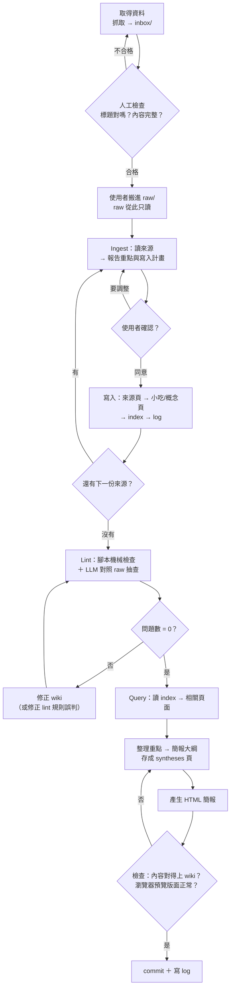

# 台灣小吃 LLM Wiki → 教學 HTML 簡報

> 繳交標題：學校 學號 系級 姓名 台灣小吃 LLM Wiki（請自行填入）

## 1. LLM Wiki 主題與簡短介紹

主題是**台灣小吃**。依 Karpathy 的 LLM Wiki 概念建立三層結構：

- `raw/`：原始資料，只讀不改
- `wiki/`：LLM 產生並維護的 markdown 知識庫
- `AGENTS.md`：規則檔，規定 ingest、query、lint 的做法

做法是先和 AI 討論規則，確定後才生成內容。共 ingest 5 份不同類型的資料（官方觀光介紹＋協作百科），整理成給初學者看的知識庫，再用它產生一份教學簡報。

## 2. LLM Wiki 連結或成果

- 目錄：[wiki/index.md](wiki/index.md)
- 規則檔：[AGENTS.md](AGENTS.md)
- 原始資料（5 份）：[raw/](raw/)
  - 交通部觀光署〈小吃飲品〉
  - 維基百科〈珍珠奶茶〉〈牛肉麵〉〈肉臊飯〉〈台灣夜市〉
- 共 23 頁：
  - 5 個來源摘要頁：[wiki/sources/](wiki/sources/)
  - 12 個小吃頁：[wiki/foods/](wiki/foods/)
  - 3 個概念頁：[wiki/concepts/](wiki/concepts/)
  - 1 個綜合頁（簡報大綱）：[wiki/syntheses/](wiki/syntheses/)
  - `index.md`、`log.md`
- 每個事實都標出處 `（來源：[[src-…]]）`。資料互相矛盾時用 `[!conflict]` 並列各方說法，例如[珍珠奶茶的發明者之爭](wiki/foods/珍珠奶茶.md)、[南北「滷肉飯」所指不同](wiki/foods/滷肉飯.md)。
- 建議用 [Obsidian](https://obsidian.md/) 開啟整個資料夾，可以看到頁面之間的連結圖。

## 3. 教學 HTML 簡報連結

- **線上瀏覽**：https://hadun5132.github.io/taiwan-snack-llm-wiki/
- 原始檔：[slides/台灣小吃入門.html](slides/台灣小吃入門.html)
- 共 15 張，用 ← → 鍵或底部按鈕翻頁；手機可以左右滑動。
- 內容順序：
  1. 夜市
  2. 小吃從哪裡來
  3. 12 道代表小吃
  4. 怎麼看起源故事
  5. 小測驗
  6. 點餐小抄
  7. 資料來源
- 每張投影片底部都標示「依據：[[wiki 頁面]] ← 來源」，可以對回 wiki。簡報各頁與 wiki 的對應整理在 [簡報大綱](wiki/syntheses/簡報大綱-台灣小吃入門.md)。

## 4. Loop / Graph 流程

文字版：取得資料 → 人工檢查 → ingest（報告 → 確認 → 寫入）→ lint → 修正 → query wiki → 整理大綱 → 產生簡報 → 檢查 → commit

會重複執行的步驟有四個：
- **ingest 迴圈**：每份來源各跑一次
- **lint 修正迴圈**：反覆修正，直到問題數歸零
- **取得資料迴圈**：資料不合格就重抓
- **簡報檢查迴圈**：不符就回到大綱重做

各迴圈的詳細說明與設計理由見 [作業說明.md](作業說明.md)。

## 5. 實際執行結果與檢查紀錄

- **操作紀錄**：[wiki/log.md](wiki/log.md)。每次 schema、ingest、query、lint 各一筆，前綴格式為 `## [日期] 操作 | 標題`。
- **檢查工具**：[tools/lint_wiki.py](tools/lint_wiki.py)，執行方式為 `python tools/lint_wiki.py wiki`。
- **版本紀錄**：git 歷史，依序是建立規則 → ingest 1 → ingest 2～5＋lint → query 與簡報。

第 1 次 lint 的結果：

| 檢查項目 | 第 1 次 | 修正後 |
|---|---|---|
| frontmatter 缺欄位 | 0 | 0 |
| 斷掉的連結 | 0 | 0 |
| 孤兒頁 | 0 | 0 |
| 事實句缺出處 | 4（腳本誤判，已修正規則） | 0 |
| 矛盾／不確定標記缺出處 | 1 | 0 |
| index 來源數過期 | 2 | 0 |
| frontmatter `sources` 和內文不一致 | 1 | 0 |
| 來源頁「影響的頁面」和實際不符 | 3 | 0 |
| **合計** | **11** | **0** |

LLM 對照原文人工抽查時，另外找到 1 處過度推論：把天婦羅列為日本傳入，但原文只說名稱來自日本。這處已改標為推論。

最後狀態：`[!conflict]` 5 個、`[!uncertain]` 8 個、`[!todo]` 10 個。

## 6. 反思

- **最常出錯的節點**：ingest 時「更新既有頁面」這一步。11 個問題裡有 10 個出在這裡。新增一份來源要同時改好幾頁，LLM 改了內文，卻常忘了更新 index 的來源數、frontmatter 和交叉引用。其次是**取得資料**：中文標題編碼錯亂，第一次 4 篇全部抓錯；「滷肉飯」條目其實是只有 70 字的消歧義頁。
- **把檢查往前移到哪裡**：
  - lint 從「最後統一做一次」，提前到「每次 ingest 之後、commit 之前」。
  - 資料檢查從「ingest 時才發現」，提前到「抓取後、放進 inbox 之前」，先確認標題和字數。
- **修改了 workflow**：
  - 加入「lint → 修正 → 再 lint」的迴圈，並把 lint 分成兩層：腳本做機械檢查，LLM 對照原文做語意抽查。
  - lint 規則本身也可以被修正：遇到誤判時，修的是規則，而不是為了通過檢查去改 wiki 的寫法。

完整說明見 [作業說明.md](作業說明.md)。
