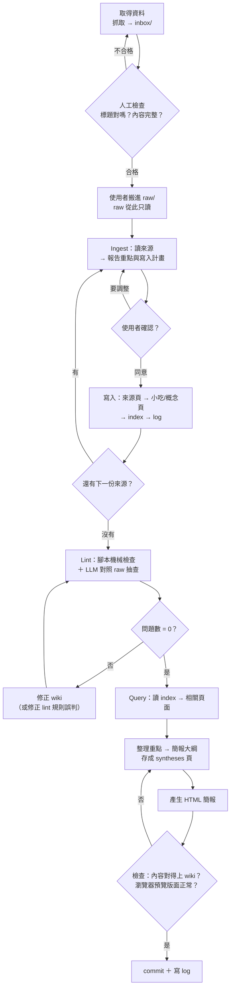

# 作業說明：用 LLM Wiki 做「台灣小吃入門」教學 HTML 簡報

## 成果一覽

| 項目 | 位置 |
|---|---|
| 規則檔（schema） | `AGENTS.md` |
| 原始資料（5 份，只讀） | `raw/`：觀光署〈小吃飲品〉＋維基百科〈珍珠奶茶〉〈牛肉麵〉〈肉臊飯〉〈台灣夜市〉 |
| LLM Wiki（23 頁） | `wiki/`：5 來源頁、12 小吃頁、3 概念頁、1 綜合頁（簡報大綱）、`index.md`、`log.md` |
| 檢查工具 | `tools/lint_wiki.py` |
| 教學簡報 | `slides/台灣小吃入門.html`（15 張，瀏覽器直接開啟，← → 翻頁） |
| 過程紀錄 | `wiki/log.md`、git 歷史 |

---

## 步驟一：建立 LLM Wiki（先討論、後生成）

1. **先討論**：與 AI 討論 4 輪（8 個問題），確定頁面類型、固定格式、引用規則、矛盾標記、中文檔名、log 前綴、index 分類、ingest 節奏，整理成 `AGENTS.md`，同意後才寫入並 commit。這個階段完全不產生 wiki 內容。
2. **後生成**：依 `AGENTS.md` 逐份 ingest，共 5 份來源。第 1 份先由 AI 報告重點和寫入計畫，經確認後才寫入；第 2～5 份經使用者明確授權批次處理。
3. 刻意挑選**類型不同**的來源（官方觀光宣傳＋協作百科），讓矛盾能被看見：最後 wiki 中有 5 個 `[!conflict]`、8 個 `[!uncertain]`、10 個 `[!todo]`。

## 步驟二：用 Wiki 做教學 HTML 簡報

- AI 先 **query** wiki（讀 `index.md` → 相關頁面），把答案存成綜合頁 `wiki/syntheses/簡報大綱-台灣小吃入門.md`，每張投影片都寫明依據哪幾頁。
- 再依大綱產生 HTML。每張投影片底部標示「依據：[[wiki 頁面]] ← 來源」，內容只取有出處的條目；資料之間有矛盾的地方，用「一說」或 ⚠ 並列呈現，不替讀者選邊。
- 內容架構：夜市（場所）→ 外來在地化（來源）→ 12 道代表小吃 → 怎麼看起源故事 → 小測驗 → 點餐小抄 → 資料來源。

---

## 步驟三：Loop / Graph 設計

文字版：**取得資料 → 人工檢查 → ingest（報告 → 確認 → 寫入）→ lint → 修正 → query wiki → 整理大綱 → 產生簡報 → 檢查 → commit**

### 哪些步驟會重複執行？

| 迴圈 | 重複什麼 | 何時停止 |
|---|---|---|
| Ingest 迴圈 | 每份來源都走一次「讀 → 報告 → 確認 → 寫入 → 記 log」 | 所有來源處理完 |
| Lint 修正迴圈 | lint → 修正 → 再 lint | 問題數歸零（本次從 11 個修到 0 個） |
| 取得資料迴圈 | 抓到的資料不合格就重抓 | 標題和內容都正確 |
| 簡報檢查迴圈 | 投影片與 wiki 不符或版面跑掉，就回到大綱或 HTML 重做 | 事實和版面都通過 |

### 哪些地方需要檢查或重新生成？

1. **資料進 raw/ 之前**：raw/ 一旦放入就不能改，所以錯的資料必須擋在 inbox/。
2. **ingest 寫入之前**：AI 先報告「打算改哪些頁、發現哪些矛盾」，人確認後才寫入，避免一次改壞很多頁。
3. **ingest 之後（lint）**：用腳本檢查缺出處、callout 沒有出處、斷掉的連結、孤兒頁、index 來源數、frontmatter 的 sources 是否和內文一致、來源頁「影響的頁面」是否屬實；再由 LLM 對照原文抽查「有沒有說得比原文更多」。
4. **簡報產生之後**：投影片事實逐條對回 wiki 頁面，並在瀏覽器實際翻頁預覽。

### 為什麼這樣設計？

- **三層分離**：raw 只讀，保證每一句話都能追回原文；wiki 是唯一的知識來源，簡報只能從 wiki 取材，不能讓 AI 憑記憶補充。
- **人在關鍵節點把關**：AI 擅長大量寫作和整理，但「哪些資料可信」「要不要改規則」由人決定。
- **機械檢查和語意檢查分開**：交叉引用、計數這類事，腳本比 LLM 可靠；「是否過度推論」只能靠 LLM 或人對照原文。
- **矛盾不刪、照實標出**：這是給初學者的教材，告訴他們「這件事有不同說法」比給一個可能錯的單一答案更誠實。

---

## 步驟四：反思（依本次實際執行紀錄）

### 1. 哪一個節點最常出錯？

**Ingest 的「寫入／更新既有頁面」節點最常出錯。** 第 1 次 lint 找到 11 個問題，其中 10 個來自 ingest 第 2～5 份時更新舊頁面：

- index 的「來源數」沒跟著更新（2 個）
- 內文引用了新來源，frontmatter 的 `sources` 卻漏列（1 個）
- 來源頁宣稱「影響了某頁」，那一頁實際上沒改（3 個）
- 不確定標記（callout）忘了附出處（1 個）

共同原因是：新增一份來源時，要**同時改好幾頁**，LLM 改了內文，卻常忘了做周邊的「記帳」。另外有 1 個是 lint 腳本自己誤判（子清單沒看上層出處），以及人工抽查找到 1 處過度推論（把「天婦羅」列為日本傳入，原文只說名稱來自日本）。

其次是**取得資料**節點：中文標題傳給 curl 時編碼錯亂，第一次 4 篇全部抓錯；改用 Python 時又遇到憑證過期；「滷肉飯」條目抓下來只有 70 字（其實是消歧義頁），最後改抓「肉臊飯」。

### 2. 發現問題後，把檢查往前移到了哪一個步驟？

- **lint 從「最後統一做一次」往前移到「每次 ingest 之後、commit 之前」**：記帳錯誤是在寫入當下產生的，越晚檢查，要追的頁面越多。
- **資料檢查從「ingest 時才發現」往前移到「抓取後、放進 inbox 前」**：先確認標題和字數合理（例如少於 200 字就要人工確認），避免把消歧義頁或亂碼放進只讀的 raw/。

### 3. 有沒有因此修改 workflow / graph？為什麼？

有。

- **graph 加了一條「lint → 修正 → 再 lint」的迴圈**，而且 lint 分成兩層：腳本做機械檢查，LLM 對照原文做語意抽查。原因是腳本抓不到「說得比原文多」這類錯誤，而 LLM 自己寫、自己檢查時，又容易漏掉計數和交叉引用。
- **lint 規則本身也是會被修正的節點**：腳本把縮排子清單誤判為缺出處，所以修改了規則（子項目沿用上層出處），而不是為了讓檢查通過去改 wiki 的寫法。
- **建議把上述兩項寫進 `AGENTS.md` 的 ingest 流程**（每次 ingest 後執行 `tools/lint_wiki.py`；抓取的資料先檢查標題與字數）。依規則，修改 AGENTS.md 需要使用者同意，並記一筆 `schema` log。
